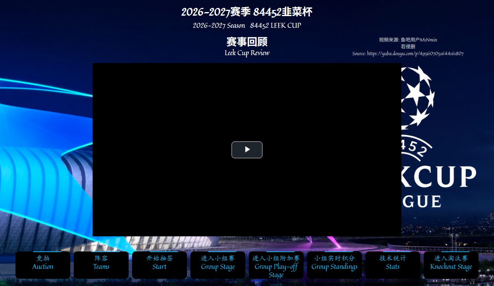
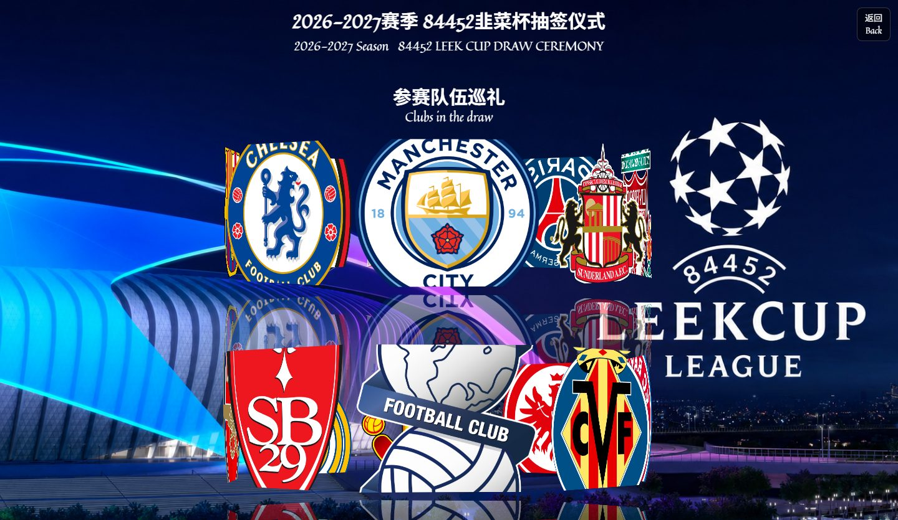
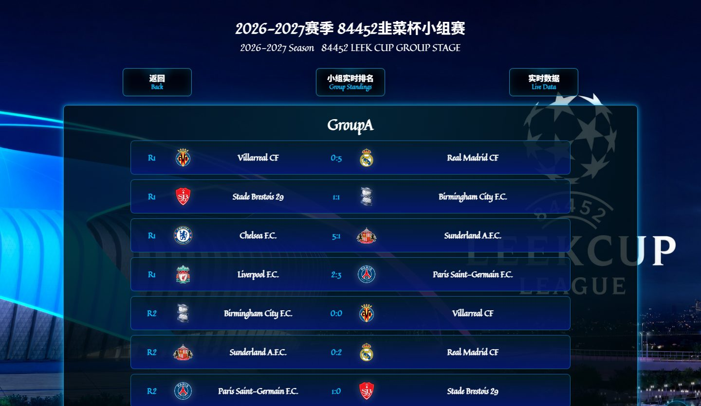
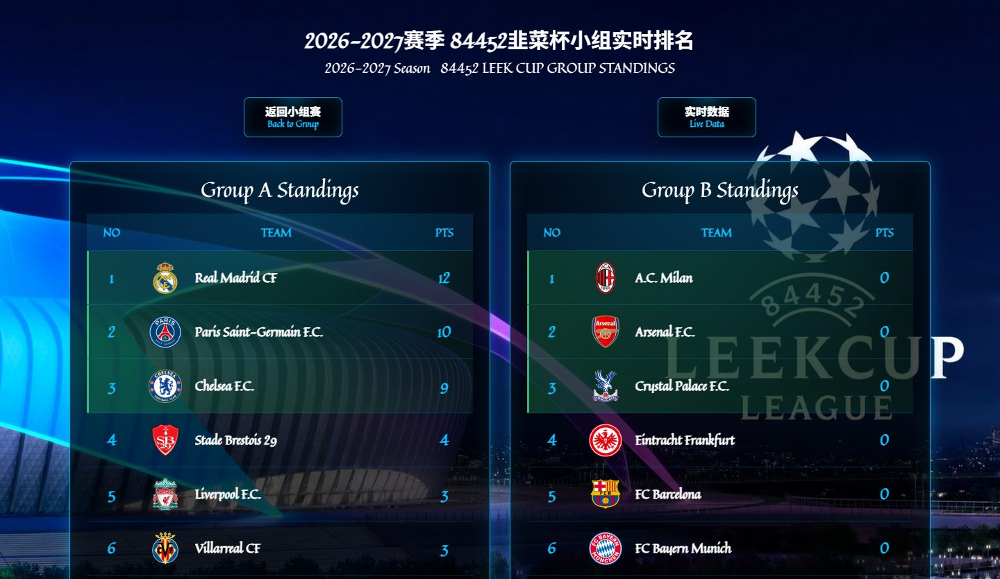
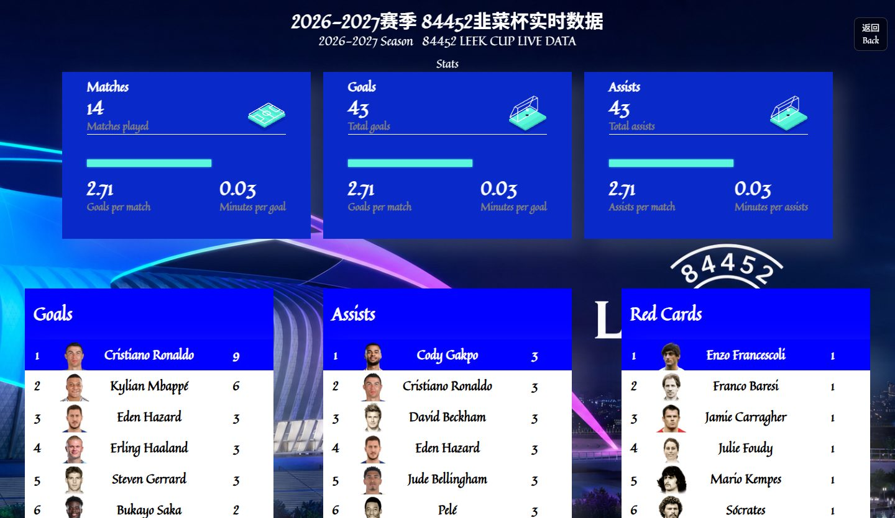

# 84452 Leek Cup (韭菜杯)

A tournament website for the **84452 Leek Cup**, a community football tournament
streamed live in China to a streamer's audience of millions. It runs the whole
season in one app: a player auction, squad building, a Champions-League-style
draw ceremony, the group stage, play-offs, live stats and the knockout bracket.

The look borrows the atmosphere of a European cup night: a 3D entrance scene,
an animated draw, theme music and a review video.



## Features

| Area | What it does |
| --- | --- |
| **3D entrance** | Three.js / react-three-fiber landing scene that leads to the main hub (`/entrance`), with a season review video. |
| **Player auction** (`/auction`) | Live bidding for 16 team accounts with per-team budgets. Supports public and sealed rounds, extra sealed rounds to break tied bids, and a big-screen display view (`/auction/display`). |
| **Teams** (`/teams`) | Squad dashboard. Each team page shows its players, budget and lineup. In admin mode a team can add players from the FC 26 player database, pick a formation and set tactics. |
| **Draw ceremony** (`/draw`) | Animated draw that splits the 16 clubs into Group A and Group B, with music and video. Admins confirm the groups; after that the draw is locked. |
| **Group stage** (`/groupstage`) | Single round-robin fixtures for each group (7 rounds). Admins enter scores and player stats per match. |
| **Standings** (`/groupstandings`) | Live tables ranked by points and goal difference, then head-to-head record and fair-play points between tied teams. The top three in each group are highlighted. |
| **Group play-offs** (`/group-playoffs`) | Cross-group ties: A4 vs B7, B4 vs A7, A5 vs B6, B5 vs A6. |
| **Stats** (`/stats`) | Tournament totals plus leaderboards for goals, assists and cards. |
| **Knockout stage** (`/knockoutstage`) | Eight-team bracket. |

| Draw ceremony | Group stage |
| --- | --- |
|  |  |

| Group standings | Live stats |
| --- | --- |
|  |  |

## Public site and admin site

The same codebase runs in two modes:

- **Public** (`leekcup.com`, or `SITE_MODE=public`): read-only. Viewers can watch
  the draw, follow fixtures and standings, and view squads.
- **Admin** (any `admin.*` host, or `SITE_MODE=admin`): every page except the
  home page and auction sits behind a login, and admin actions are enabled:
  confirming groups, entering results, editing squads and resetting the tournament.

The auction has its own login and roles (admin, bidder), separate from the site login.

## Tech stack

- [Next.js 16](https://nextjs.org) (App Router, `src/proxy.ts` for route protection), React 19, TypeScript
- Tailwind CSS 4
- Three.js with `@react-three/fiber` and `@react-three/drei`, GSAP
- Video.js, react-audio-player, react-countup
- [Supabase](https://supabase.com) (Postgres) through its REST API for teams, players, results and the auction

## Getting started

### 1. Install

```bash
npm install
```

### 2. Configure environment

Copy `.env.example` to `.env.local` and fill in the values:

| Variable | Purpose |
| --- | --- |
| `SITE_MODE` | `public` or `admin`. Hostnames (`admin.*`, `leekcup.com`) take priority over this. |
| `SITE_USERNAME`, `SITE_PASSWORD` | Admin site login. |
| `SITE_AUTH_SECRET` | Secret used to sign the admin session cookie. |
| `SUPABASE_URL`, `SUPABASE_SERVICE_ROLE_KEY` | Supabase project. The service role key is used only on the server. |
| `AUCTION_AUTH_SECRET` | Optional. Signs auction sessions; falls back to `SITE_AUTH_SECRET`. |
| `AUCTION_SETUP_SECRET` | Required to call the auction setup endpoint. |

### 3. Set up the database

Apply the SQL files in [`supabase/migrations`](supabase/migrations) to your
Supabase project in filename order (for example with `supabase db push`). They
create the player, auction, session, tactics and lineup tables and seed the 16
auction team accounts.

### 4. Run

```bash
npm run dev
```

Open <http://localhost:3000>. To try the admin features locally, set `SITE_MODE=admin`.

## Scripts

| Command | Description |
| --- | --- |
| `npm run dev` | Start the development server |
| `npm run build` | Build for production |
| `npm run start` | Serve the production build |
| `npm run lint` | Run ESLint |
| `node --test tests/*.test.mjs` | Run the unit tests (Node 22.6+ for TypeScript imports) |

## Project structure

```
src/
  app/            Pages (auction, teams, draw, groupstage, ...) and API routes under app/api
  components/     UI grouped by feature (auction, draw, entrance, groupstage, teams, ...)
  data/           Static team data used by the draw
  lib/            Auth, Supabase REST helpers, group-stage logic, formations
  proxy.ts        Admin-site route protection
supabase/
  migrations/     Database schema and seed data
public/           Club badges, fonts, 3D model, audio and video
tests/            Node test runner unit tests
docs/screenshots/ Images used in this README
```

## Deployment

The app is built for [Vercel](https://vercel.com). Deploy it twice, or point two
domains at one deployment: the public domain for viewers and an `admin.`
subdomain for organisers. Set the environment variables above in the Vercel project.
